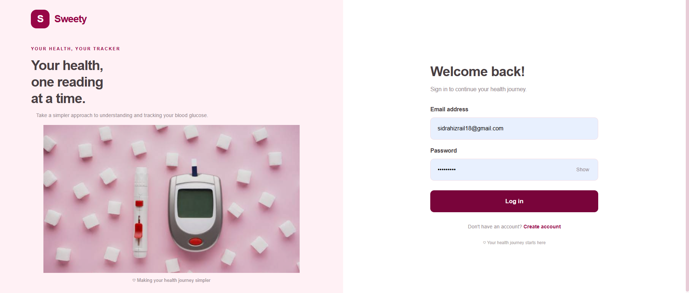
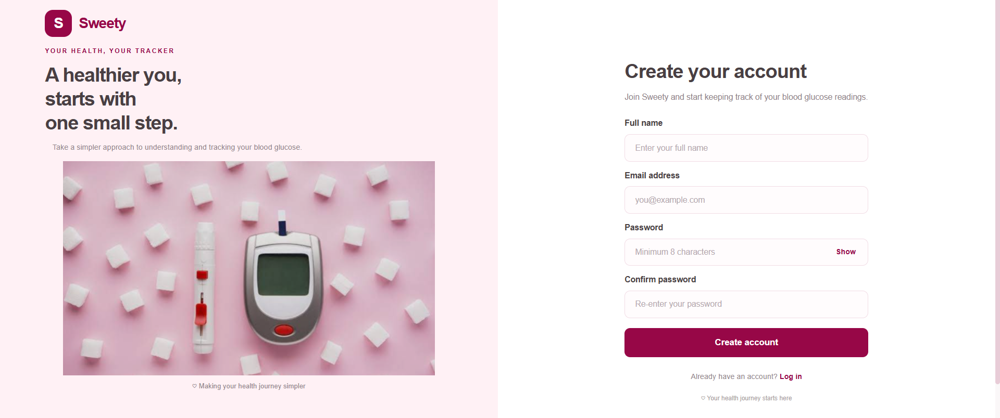
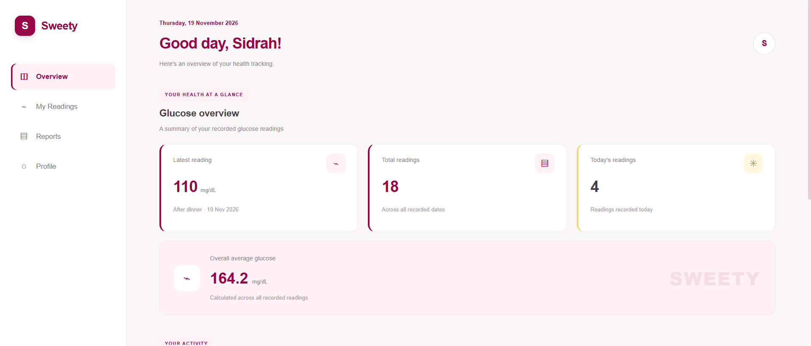
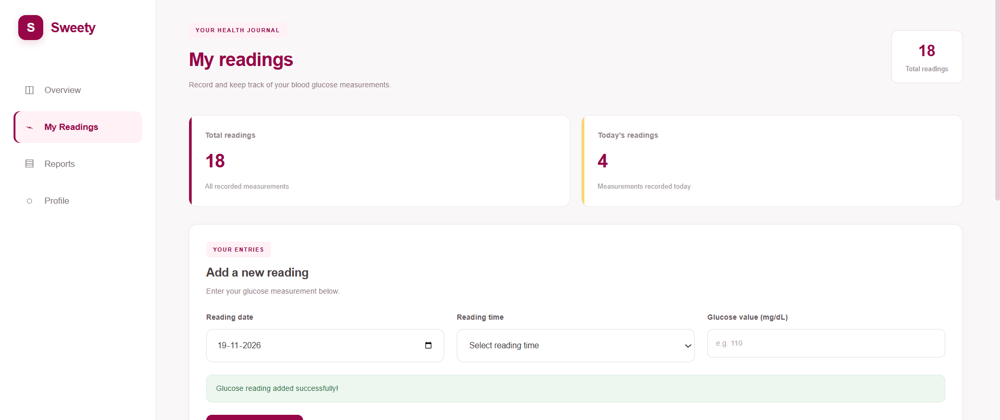
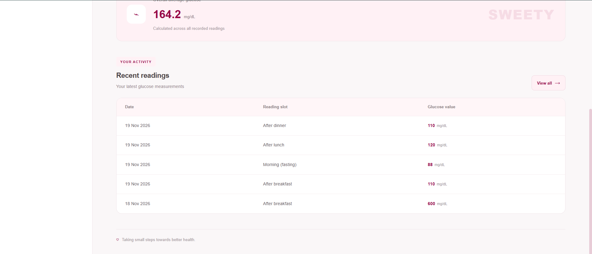
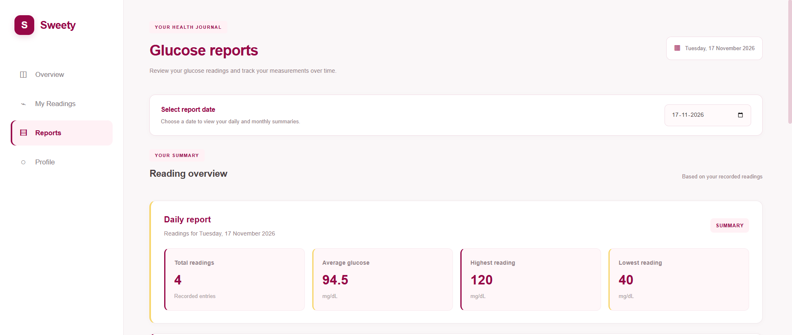
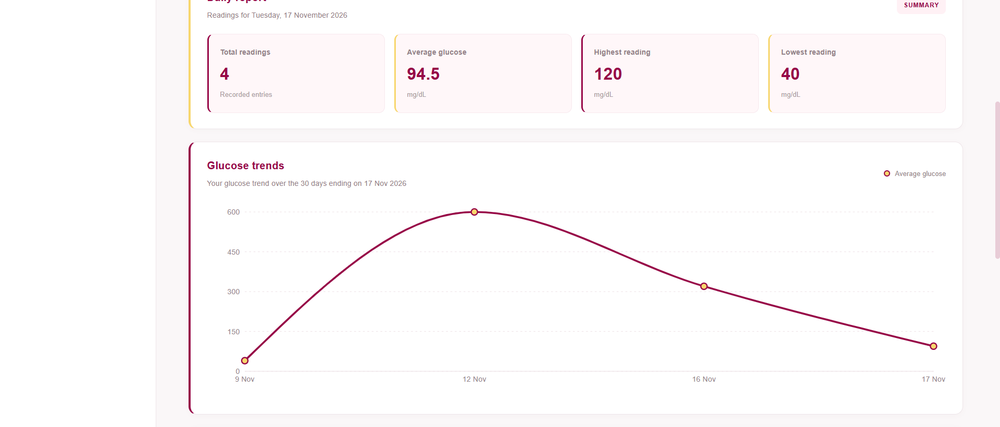
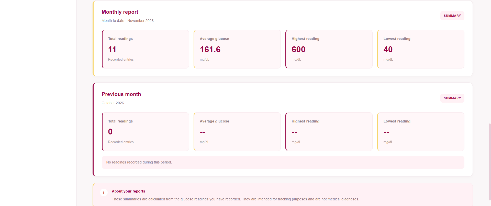
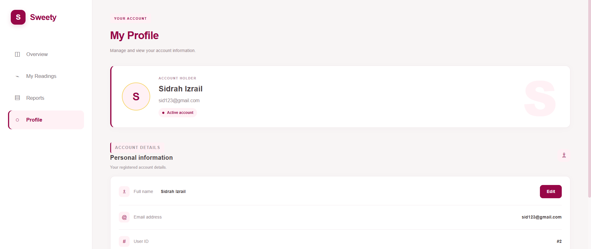

# Sweety – Blood Glucose Tracker

Sweety is a full-stack blood glucose tracking application that helps users securely record, manage, and monitor their daily glucose readings. It provides a dashboard, reading history, charts, and reports to help users understand their glucose trends.

Developed as part of the **Junior Full Stack Developer – JavaScript & AI assessment by Kenpath**.

## Features

### Authentication
- User registration and login.
- Password hashing using bcrypt.
- JWT-based authentication.
- Secure, user-specific reading access.

### Blood Glucose Management
- Add, view, edit, and delete glucose readings.
- Four daily reading slots:
  - Morning (fasting)
  - After breakfast
  - After lunch
  - After dinner
- Maximum of four readings per day.
- Prevents duplicate readings for the same slot and date.
- Validates glucose values and dates.

### Dashboard and Reports
- Dashboard summary with total readings, today's readings, and average glucose.
- Glucose charts and reading history.
- Daily reports.
- Month-to-date reports.
- Previous-month reports.
- Pagination for reading history.
- Empty states when no readings are available.

### Additional Features
- Docker and Docker Compose support.
- PostgreSQL database seed script.
- Automated end-to-end tests using Playwright.

## Technology Stack

**Frontend**
- React
- Vite
- JavaScript
- CSS
- Axios
- Recharts

**Backend**
- Node.js
- Express.js
- REST APIs

**Database**
- PostgreSQL
- pg (Node.js PostgreSQL client)

**Authentication**
- bcrypt
- JSON Web Tokens (JWT)

**Tools and Testing**
- Docker
- Docker Compose
- Playwright
- Git and GitHub

## Project Structure

```text
Sweety/
├── client/
│   ├── src/
│   │   ├── components/
│   │   ├── pages/
│   │   ├── services/
│   │   └── styles/
│   ├── Dockerfile
│   ├── nginx.conf
│   └── package.json
│
├── server/
│   ├── config/
│   ├── controllers/
│   ├── middleware/
│   ├── routes/
│   ├── seed.js
│   ├── server.js
│   ├── Dockerfile
│   ├── .env.example
│   └── package.json
│
├── database/
│   └── init.sql
│
├── tests/
├── Screenshots/
├── docker-compose.yml
└── README.md
```

## Installation and Setup

### Prerequisites

Install the following:

- Node.js and npm
- PostgreSQL
- Git

Docker Desktop is optional if you prefer running the application using Docker.

### 1. Clone the Repository

```bash
git clone https://github.com/sidrah008-del/Sweety.git
cd Sweety
```

### 2. Database Setup

Create a PostgreSQL database named `sweety_db`.

```sql
CREATE DATABASE sweety_db;
```

Initialize the database tables using the provided SQL file:

```bash
psql -U postgres -d sweety_db -f database/init.sql
```

Make sure PostgreSQL is running and your database credentials are correct.

### 3. Backend Setup

Navigate to the server directory:

```bash
cd server
npm install
```

Create a `.env` file using `.env.example` as a reference.

On Windows PowerShell:

```powershell
Copy-Item .env.example .env
```

Configure the environment variables:

```env
DB_HOST=localhost
DB_PORT=5432
DB_NAME=sweety_db
DB_USER=postgres
DB_PASSWORD=your_password

PORT=5000

JWT_SECRET=your_long_random_secret
```

Replace the database password and JWT secret with your own values.

Start the backend:

```bash
npm start
```

The backend runs at:

`http://localhost:5000`

### 4. Frontend Setup

Open another terminal from the project root:

```bash
cd client
npm install
```

Create a `.env` file in the client directory if required by your local configuration:

```env
VITE_API_URL=http://localhost:5000
```

Start the frontend:

```bash
npm run dev
```

Open the local URL displayed by Vite in your terminal.

## Running with Docker

Docker Compose starts the PostgreSQL database, Node.js backend, and React frontend.

From the project root, make sure `server/.env` exists and contains the required database credentials and JWT secret.

Run:

```bash
docker compose --env-file server/.env up -d --build
```

The Docker configuration uses:

| Service | Address |
|---|---|
| Frontend | http://localhost:8080 |
| Backend | http://localhost:5000 |
| PostgreSQL (host port) | localhost:5433 |

Useful Docker commands:

**Check running containers**

```bash
docker compose ps
```

**View backend logs**

```bash
docker compose logs server
```

**Stop containers**

```bash
docker compose down
```

The PostgreSQL data is stored in a Docker volume named `postgres_data`. Avoid using `docker compose down -v` if you want to preserve database data.

## Demo Account and Database Seeding

Sweety includes a database seed script at:

`server/seed.js`

The script creates a demo user if one does not already exist and generates sample glucose readings for the previous seven days.

It uses bcrypt to hash the demo password and avoids inserting duplicate readings.

To execute the seed script with your local PostgreSQL database:

```bash
cd server
node seed.js
```

### Demo Login Credentials

| Field | Value |
|---|---|
| Name | Sweety Demo |
| Email | demo@sweety.com |
| Password | SweetyDemo@123 |

The demo password applies when the seed script creates a new account. If the account already exists, the script preserves its existing password.

## Testing

Sweety uses Playwright for automated end-to-end testing.

Install the client dependencies first:

```bash
cd client
npm install
npx playwright install chromium
```

Start the backend and frontend before running the end-to-end tests.

From the project root, execute:

```bash
npx playwright test
```

To run tests with the browser visible:

```bash
npx playwright test --headed
```

The test suite includes authentication and application workflow tests.

## Screenshots

Screenshots demonstrating the application are available in the `Screenshots` directory.

### Login


### Registration


### Dashboard


### Glucose Readings




### Reports and Analytics






### Profile


## Environment Variables

The backend environment variable template is provided in:

`server/.env.example`

Create your own `.env` file with the appropriate local database credentials and authentication secret.

Never commit actual passwords, JWT secrets, or other private credentials to GitHub.

## Notes and Future Improvements

- PostgreSQL is used for persistent storage of user accounts and glucose readings.
- Passwords are securely hashed using bcrypt.
- JWT authentication protects user-specific reading data.
- Database constraints and application-level validation help maintain data integrity.
- Docker Compose simplifies local application setup.
- Playwright provides automated end-to-end testing.

With more development time, I would improve the application through:
- More comprehensive frontend component testing.
- Additional glucose analytics and visualization options.
- Improved accessibility and responsive design.
- Automated reading reminders.
- Expanded test coverage and error handling.

## Author

**Sidrah Izrail**

GitHub: [sidrah008-del](https://github.com/sidrah008-del)

**Project Repository:** [Sweety – Blood Glucose Tracker](https://github.com/sidrah008-del/Sweety)

---

Built with React, Node.js, Express, and PostgreSQL.